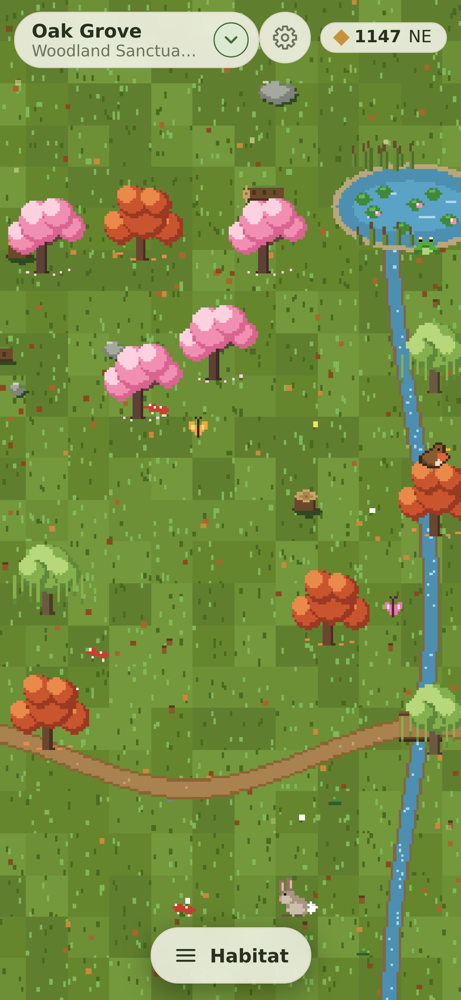
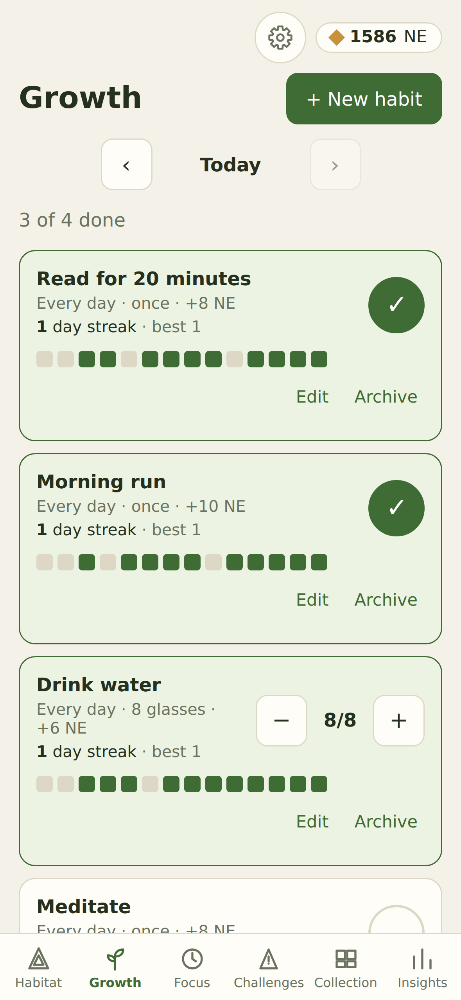
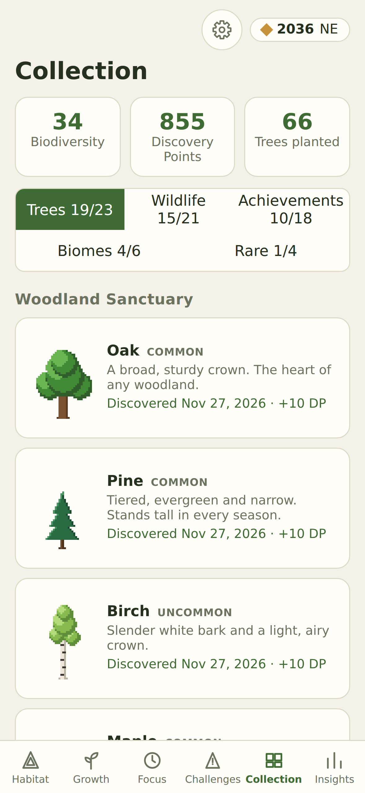
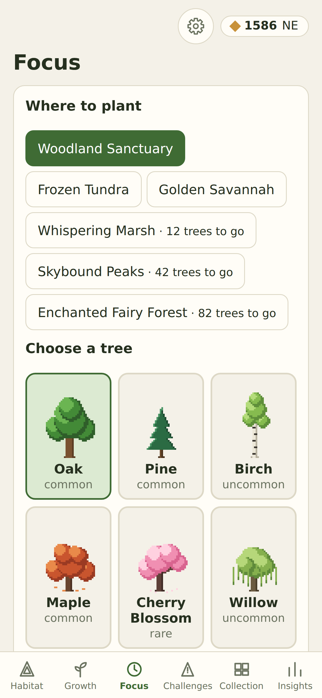
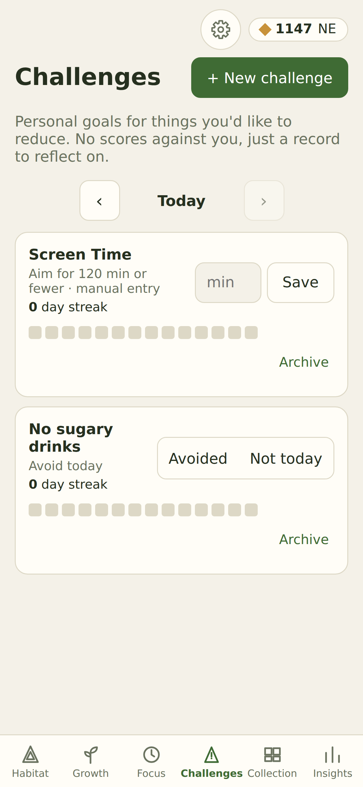
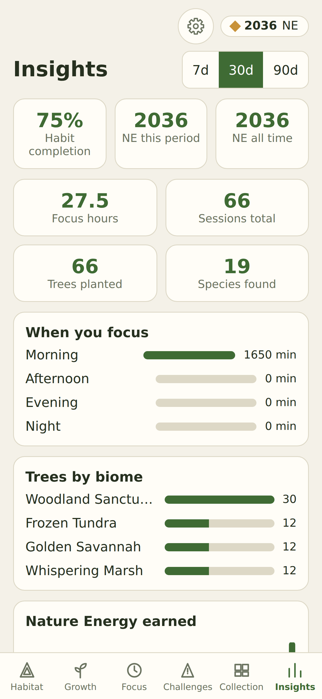

# Habitat

**Build a better life, one habit at a time.**

Habitat turns the things you do for yourself into a living world. Track your habits, focus without distractions, and every focus session you finish plants a tree that stays for good. Over time a bare clearing grows into forests, tundra, savannah, marsh, floating islands and a fairy wood, full of wildlife that moves in as it grows.

It works in your phone's browser, can be added to your home screen like an app, and keeps everything on your device. There is no account to make and nothing to sign up for.

  
  
  

## What you can do

### Grow habits
Set up daily habits, weekly goals or custom days, with a target such as "8 glasses of water". Tick them off, watch your streaks build and earn **Nature Energy** for every habit you complete.

### Focus, and plant a tree
Choose a tree, set a timer and put your phone down. Finish the session and the tree is planted for real, in a world that remembers it. Pause if you need to, minimise the timer while you carry on in the app, and the session keeps counting even if your phone goes to sleep.

### Watch your world fill up
Your habitat is a hand-drawn pixel-art landscape with ponds, streams and paths. Trees grow through five stages, wildlife wanders in, and you can pinch to zoom in on the details. Day turns to night, the seasons change, and there is gentle weather and, if you want it, soft generated sound and music.

### Unlock new places
You start in the **Woodland Sanctuary**. Plant more trees to open new worlds:

| World | Opens at | Feel |
|---|---|---|
| Woodland Sanctuary | Start | Broadleaf trees and wildlife, with the colours of each season |
| Frozen Tundra | 15 trees | Snowy pines, frost and quiet |
| Golden Savannah | 35 trees | Acacia and baobab under a warm sky |
| Whispering Marsh | 60 trees | Mangroves, still water and frogs |
| Skybound Peaks | 90 trees | A floating island among the clouds |
| Enchanted Fairy Forest | 130 trees | Glowing trees and lights at night |

### Collect and discover
Every tree species, creature and rare find you uncover is kept in your **Collection**, along with achievements for streaks, focus time and exploring. Some discoveries are rare and turn up only now and then.

### Take on challenges
Challenges help you cut back on things, such as screen time or sugary drinks. Set a daily limit or go for a clean day, and log how you did.

### See how you are doing
Insights show your progress over time, so you can see which habits are sticking and how much focus time you have put into your world.

## Made for your phone and your privacy

- **Private by default.** Your habits, trees and progress live only on your device.
- **Works offline.** Once opened, it runs without a connection.
- **Your data is yours.** Export a backup file at any time and import it on another device.
- **Calm and accessible.** Reduced-motion and lower-quality options, optional sound that is off until you turn it on, and optional click sounds.

## Try it

Open the site in your phone's browser and use **Add to Home Screen** for the full-screen app experience. It is built to be used upright on a phone.

## For developers

Setup, architecture, the deploy process and notes for contributors are in [docs/DEVELOPMENT.md](docs/DEVELOPMENT.md). The product vision is in [project_brief.md](project_brief.md).

The screenshots above are generated automatically from the app, at iPhone 16 size, whenever `main` is updated.
